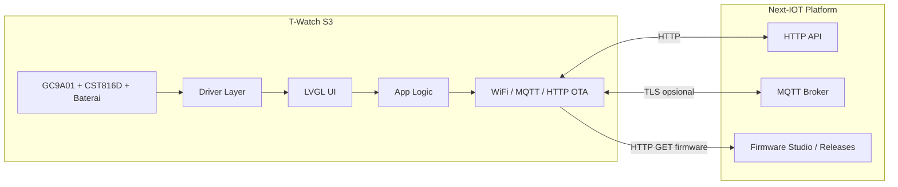

# Arsitektur — Next-OS Wear v1

## Gambaran sistem

Perangkat adalah klien edge: menampilkan telemetry & alert, mengirim perintah irigasi (fase berikutnya), dan menerima update firmware terkontrol.

## Lapisan software (bottom-up)

| Lapisan | Modul | Keterangan |
|---------|--------|------------|
| Hardware | ESP32-S3, PSRAM 8MB | Flash 8MB, partition default |
| Driver | `display.cpp`, `touch.cpp` | GC9A01 SPI, touch CST816D (I2C) |
| UI | LVGL 9, `src/screens/*` | 240×240 round, tema Tactical Warm Cream |
| App | `app.cpp` | Lifecycle layar, event antar-screen (`events.h`) |
| Connectivity | `wifi.cpp`, `mqtt.cpp`, `ota.cpp` | MQTT stub Week 7–10; OTA HTTP + SHA256 (desain) |

## Memori

- **Flash:** kode aplikasi + asset font/bitmap (nanti).
- **PSRAM (~2MB usable untuk LVGL):** buffer draw LVGL partial (hardware: strip 20 baris × lebar layar).
- **RAM internal:** state WiFi, stack task, variabel global minimal.

Simulator PC tidak memakai PSRAM; SDL menangani framebuffer.

## Alur OTA (desain Week 7–10)

1. **Firmware Studio** (platform Next-IOT) menerbitkan artefak `.bin` + metadata (versi, SHA256, URL).
2. Perangkat polling atau menerima perintah MQTT `firmware/update_available`.
3. `ota.cpp` mengunduh via **HTTPClient** / **HTTPUpdate**, memverifikasi **SHA256**, lalu `Update.begin()` / `Update.write()` / `Update.end()`.
4. Reboot ke partisi baru; laporkan versi ke MQTT `device/{id}/state`.

Rollback: simpan partisi factory + flag boot aman (implementasi bertahap).

## Alur pairing (desain)

1. Saat boot pertama, layar menampilkan **QR** (device id + nonce).
2. Operator membuka web Next-IOT / mobile field app, scan QR.
3. Backend mengikat `device_id` ke **tenant** + sertifikat/kredensial MQTT.
4. Perangkat menyimpan token di NVS (bukan di git).

## Simulator vs hardware

| Aspek | `env:simulator` | `env:lilygo-t-watch-s3` |
|-------|-----------------|-------------------------|
| Entry | `simulator/main_sim.cpp` | `src/main.cpp` |
| Display | LVGL SDL | Arduino_GFX GC9A01 |
| Touch | Mouse SDL | `touch.cpp` CST816D |
| Define | `NEXT_OS_SIMULATOR` | `NEXT_OS_HARDWARE` |

Layar di `src/screens/` dikompilasi bersama `app.cpp` di kedua target (filter sumber di `platformio.ini`).

## Keamanan

- Credential hanya di `config.h` lokal / build flags / NVS.
- TLS untuk MQTT/API di fase produksi (sertifikat root di flash).
- OTA hanya dari URL yang ditandatangani / diverifikasi hash oleh platform.

## Roadmap singkat

1. Week 1–2: skeleton + simulator (dokumen ini).
2. Week 3–6: watch face, sensor monitor, navigasi.
3. Week 7–10: MQTT penuh, OTA, pairing QR.
4. Week 11+: optimasi baterai, haptic, field hardening.
