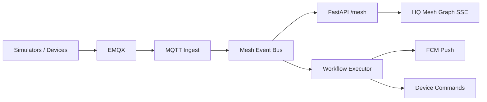

# Smart Farming Universal Mesh — Phase 1 Complete

Phase 1 spans Weeks 1–12: thing model, event bus, workflows, simulators, HQ mesh graph, FCM + scheduler + E2E demo.

## Architecture (Mermaid)



## Capability matrix (summary)

| Domain | Example capabilities | Simulator |
| --- | --- | --- |
| vision | motion_detected | cctv |
| motion | dispatch, waypoint | drone |
| actuator | valve, spray | sprayer, gate |
| sensor | reading, forecast | weather |
| ui | alert, ack | cyberdeck, smartwatch |
| security | intrusion | alarms hook |

## Preset workflows

1. Smart Irrigation Extended  
2. Farm Pest Response  
3. Security Patrol Night  
4. Harvest Coordination  

Seed: `python scripts/seed_mesh_preset_workflows.py --tenant-slug <slug>`

## FCM + SSE setup

- API env: `NOTIFICATION_FCM_ENABLED`, `FCM_PROJECT_ID`, `FCM_PRIVATE_KEY_JSON` (base64 service account JSON)
- Register token: `POST /api/v1/notifications/fcm/register` (e.g. field app or future edge UI)
- HQ mesh graph uses SSE `/api/v1/mesh/events/stream` with Bearer JWT

## E2E demo

```bash
docker compose --profile simulators up -d
python scripts/demo_farm_pest_response.py --skip-compose
```

Report: `/tmp/demo-pest-response-*.md`

## Phase 2 hardware roadmap

- Native firmware on ESP32-S3 / LILYGO T-Watch S3 (Next-OS edge), replacing smartwatch simulator where applicable
- Physical CCTV / sprayer MQTT devices on tenant bus
- Production FCM project for operator push (field app / devices)
