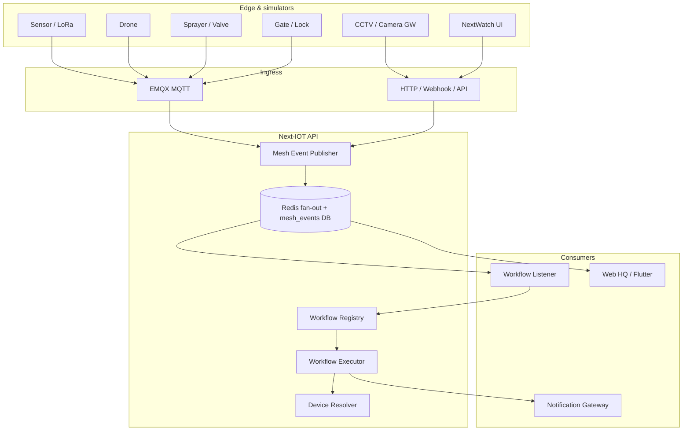
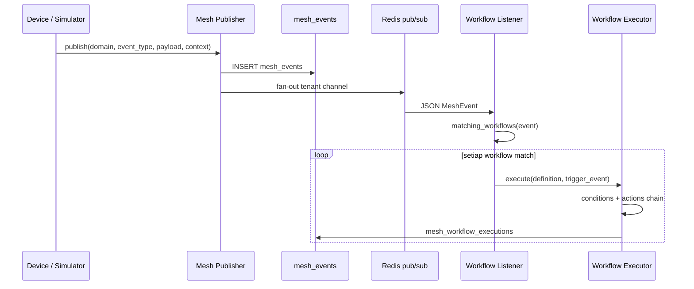
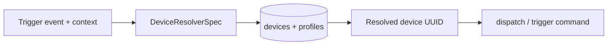
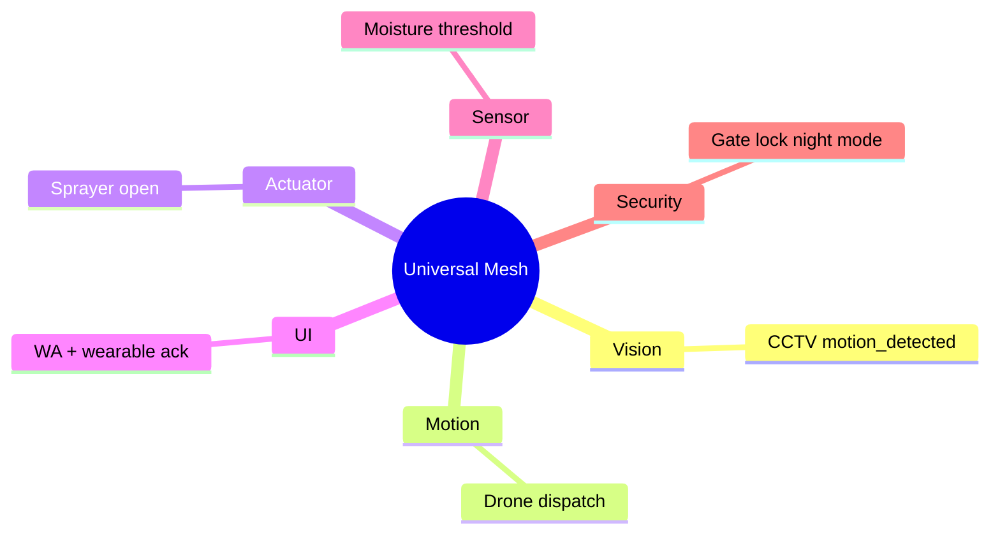

# Universal Device Mesh — Arsitektur Next-IOT untuk Ekosistem IoT Indonesia

**Audience:** Founder / CTO tech-savvy yang mau implement smart farming, security, atau operasi lapangan multi-perangkat di Indonesia.  
**Repo:** [Next-IOT](https://github.com/) (monorepo: `apps/api`, `apps/web`, `apps/mobile`, `apps/firmware/next-os-wear`)  
**Status platform (Okt 2026):** Phase 1 Universal Mesh (backend), Phase 2 NextWatch (simulator firmware), Step 8C (AI Copilot, Camera Gateway stub, Analytics advanced).

---

## Hook: Mengapa platform IoT biasa gagal di Indonesia?

Tiga pain point yang kami lihat berulang di lapangan:

1. **Domain terpisah, otomasi putus.** Sensor kebun di satu dashboard, drone di app vendor lain, CCTV di NVR, irigasi di controller lokal. Saat hama muncul, manusia jadi router antar sistem — bukan software.
2. **Integrasi “global” tidak pas konteks lokal.** Notifikasi email/Slack enterprise kurang relevan untuk petani; BMKG, zona WIB, dan WhatsApp (via gateway seperti Fonnte) sering jadi afterthought.
3. **Pilot mahal sebelum bukti nilai.** Tanpa hardware lengkap, tim engineering sulit demo end-to-end; stakeholder kehilangan kepercayaan sebelum satu hektar pun terukur.

Next-IOT dirancang untuk menutup ketiga celah itu dengan **satu event bus multi-domain**, **workflow DSL**, dan **simulator** sehingga pilot bisa jalan sebelum semua node fisik terpasang.

---

## Problem statement: Single-domain tidak scale cross-domain

Platform seperti Tuya unggul di smart home (switch, lamp, plug) dengan ekosistem consumer yang matang. ThingsBoard dan AWS IoT Core unggul di telemetry + rule engine enterprise — tetapi orchestration **lintas jenis perangkat** (vision → motion → actuator → UI) biasanya dibangun custom per proyek.

Kebutuhan smart farming Indonesia (dan operasi serupa) lebih mirip **orkestra**:

| Peran | Contoh perangkat | Domain mesh |
| --- | --- | --- |
| Sensing | Soil moisture, weather | `sensor` |
| Vision | CCTV, ESP32-CAM | `vision` |
| Motion | Drone dispatch | `motion` |
| Actuation | Sprayer, valve | `actuator` |
| Security | Gate, lock | `security` |
| Human loop | Wearable, dashboard ack | `ui` |

Tanpa **vocabulary event** dan **resolver perangkat** yang sama, setiap integrasi baru = proyek one-off. Biaya maintenance naik linear dengan jumlah vendor.

---

## Solution: Universal Device Mesh

Inti desain: setiap perubahan bermakna di edge (sensor, kamera, drone, actuator) dipublish sebagai **MeshEvent** dengan:

- `tenant_id` (isolasi multi-tenant)
- `device_id` + **context** (farm, plot, zone, geo, capabilities)
- `domain` + `event_type` (whitelist per domain)
- `correlation_id` / `parent_event_id` untuk rantai kausal
- Persistensi (`mesh_events`) + fan-out Redis + MQTT topic hierarchy

Workflow **declarative** (JSON DSL) mendengarkan event atau cron, mengevaluasi kondisi, lalu menjalankan rantai action: dispatch drone, trigger valve, notification, alarm, log.

---

## Enam domain event (standar platform)

Definisi resmi ada di `apps/api/app/mesh/event_bus.py` (`MeshDomain`):

| Domain | Contoh `event_type` |
| --- | --- |
| `sensor` | `reading_update`, `threshold_exceeded`, `weather_forecast` |
| `vision` | `motion_detected`, `object_detected`, `anomaly_detected` |
| `motion` | `dispatch_requested`, `flight_started`, `waypoint_reached` |
| `actuator` | `state_changed`, `command_sent`, `tank_level_low` |
| `security` | `intrusion_detected`, `lock_engaged`, `access_granted` |
| `ui` | `user_acknowledged`, `user_action_triggered`, `alert_shown` |

Validasi tipe event per domain mencegah “string bebas” yang tidak bisa di-match workflow.

---

## Alur publish → workflow trigger

**Correlation:** Action downstream bisa publish event anak dengan `parent_event_id` mengacu event pemicu — audit trail untuk demo “Farm Pest Response” dan compliance internal.

---

## Workflow execution timeline (contoh sequential)

Preset **Farm Pest Response** (`seed_preset_workflows.py`, key `farm_pest_response`):

```mermaid
gantt
  title Farm Pest Response (ilustrasi timeline)
  dateFormat X
  axisFormat %S s

  section Trigger
  motion_detected (vision)     :0, 1

  section Conditions
  Drone available nearest plot :1, 2

  section Actions
  dispatch_device fly_to       :2, 5
  wait_for_event / capture     :5, 8
  trigger_device spray         :8, 11
  notification WhatsApp        :11, 12
  log_event                    :12, 13
```

Engine mendukung action types: `dispatch_device`, `trigger_device`, `wait_for_event`, `notification`, `set_attribute`, `create_alarm`, `log_event` — divalidasi Pydantic di `workflow_schema.py`.

---

## Device Resolver pattern

Workflow tidak hard-code UUID device. Resolver memilih target by:

- **capability** (dari device profile, mis. `can_fly_to`, `can_spray`, `can_detect_motion`)
- **zone** / `physical_zone`
- **farm_id** / **plot_id** (context agriculture)
- **nearest_to** (geo `{lat,lng}` — haversine di `device_resolver.py`)
- **device_id** eksplisit (escape hatch)

Ini yang memungkinkan **1 workflow** tetap valid meski device diganti — asalkan capability dan zone konsisten.

---

## Cross-domain composition: 1 + 1 = 3

Nilai bukan di jumlah dashboard, tapi di **event chain** yang bisa di-test, di-version, dan di-audit (`mesh_workflow_executions`).

---

## Use case konkret: Farm Pest Response (step-by-step)

**Persona ilustrasi:** Pak Hendra, kebun kopi 3 plot — *bukan testimonial pelanggan nyata*.

1. **Vision:** Kamera (`vision/motion_detected`, payload `confidence ≥ 0.75`) — ingress via Camera Gateway stub (`POST /api/v1/cameras/{id}/ingest-motion`) atau simulator CCTV.
2. **Matching:** Workflow listener memuat definisi preset “Farm Pest Response” untuk tenant.
3. **Condition:** Device resolver cari drone `can_fly_to` terdekat geo plot (`nearest_to` template dari context).
4. **Actions:**
   - `dispatch_device` → `fly_to` / inspect
   - `wait_for_event` (vision NDVI / capture) optional di preset
   - `trigger_device` → sprayer
   - `notification` → template WhatsApp (channel gateway)
   - `log_event` untuk audit
5. **Human loop:** Operator ack di cyberdeck / NextWatch (`ui/user_action_triggered`) jika workflow memerlukan.

E2E diverifikasi di pytest (`tests/mesh/test_e2e_demo.py`, `tests/cameras/test_cameras.py` — motion → match preset).

---

## Komponen pendukung (Phase 1 + Step 8C)

| Komponen | Fungsi |
| --- | --- |
| **6 mesh simulators** | `cctv`, `sprayer`, `cyberdeck`, `gate`, `weather`, `smartwatch` — in-process, zero hardware |
| **AI Copilot (Step 8C)** | NL → workflow DSL; mock tanpa API key |
| **Camera Gateway stub** | RTSP registry, snapshot placeholder, motion → mesh |
| **Analytics advanced** | CSV export, scheduled reports, energy kWh estimate |
| **NextWatch simulator** | LVGL + SDL2; mock MQTT → mesh UI sync |
| **Alembic** | Migrasi melalui revisi **040** (`mesh_events`, `mesh_workflows`, `cameras`, `scheduled_reports`, …) |

Angka verifikasi (Docker API container, Okt 2026): **584** test case terkumpul di suite pytest API; Step 8C menambah **14** test lulus (copilot + cameras + analytics + model registration).

---

## Indonesia-first: bukan sekadar translate UI

- **Bahasa & copy** workflow notification bisa Bahasa Indonesia.
- **WhatsApp** sebagai channel first-class di notification gateway (integrasi Fonnte / sejenis — config tenant).
- **BMKG / cuaca** masuk domain `sensor` (`weather_forecast`) — hook untuk data lokal.
- **Hardware lokal & LoRa** path sudah ada di agriculture vertical + LoRa bridge; mesh tidak mengunci vendor barat saja.
- **Pilot tanpa impor penuh:** simulator + firmware SDL memungkinkan demo di WSLg / laptop sebelum LILYGO tiba.

---

## Comparison matrix (high level)

| Kriteria | Tuya | ThingsBoard | AWS IoT | Next-IOT Universal Mesh |
| --- | --- | --- | --- | --- |
| Fokus utama | Consumer smart home | Telemetry + rules | Cloud scale + bespoke | **Cross-domain orchestration** |
| Multi-domain event bus | Terbatas ekosistem sendiri | Custom rule chains | IoT Events + Lambda DIY | **6 domain + DSL bawaan** |
| Smart farming preset | Minimal | Custom build | Custom build | **4 preset workflows + seed** |
| WA / lokal | Bukan core | Plugin | SNS / partner | **Notification gateway + ID copy** |
| Zero-hardware demo | App demo terbatas | Simulator partial | Costly test env | **6 simulators + pytest E2E** |
| Wearable / edge UI | App vendor | Custom | Custom | **NextWatch + mesh UI sync** |
| Self-host pilot | Cloud-first | On-prem possible | Cloud | **Docker Compose dev stack** |

*Matrix ini perbandingan arsitektural, bukan benchmark performa numerik.*

---

## Evolusi repo (credibility signal)

Contoh commit riil (mesh + Step 8C):

- `5f9ef89` — AI Copilot NL → workflow DSL  
- `aea4be1` — Camera Gateway stub  
- `6b3938f` — Analytics advanced  
- `037_mesh_workflows` / `036_mesh_events` — fondasi workflow engine  

Firmware: navigation stack, farming hub, mesh graph di simulator (`apps/firmware/next-os-wear`).

---

## Call to action

**Ingin pilot Next-IOT di kebun atau operasi lapangan lo?**  
Hubungi **NextGrow** — kami buka slot terbatas untuk pilot smart farming / multi-device (hardware + simulator-first onboarding).

- Demo stack: Docker Compose + Web HQ + Field App  
- Technical deep-dive: repo `apps/api/app/mesh/`  
- Dokumentasi lanjutan: `docs/PROJECT_RESUME.md`

---

*Dokumen ini deskripsi arsitektur berdasarkan implementasi aktual di monorepo Next-IOT. Fitur “planned” disebut eksplisit di roadmap (mis. open source Q1 2027), bukan sebagai produk yang sudah dijual.*
