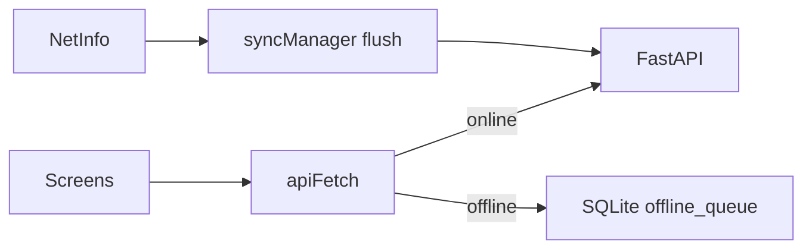

# Next-IOT Field Mobile Architecture

## Stack

- **Expo SDK 51** + React Native
- **React Navigation** — Auth stack vs main tabs
- **Zustand** — auth, devices, alerts, offline state
- **TanStack Query** — wired at app root (extensible per screen)
- **Expo SecureStore** — JWT access token
- **Expo SQLite** — offline action queue

## Data flow

## Push notifications

1. App requests Expo notification permission.
2. Expo push token → `POST /api/v1/users/me/push-token`.
3. Critical workflow alerts → `send_push()` (Expo Push API).
4. Tap notification → navigate to alert detail (payload `alertId`).

## Related packages

| App | Path |
|-----|------|
| Expo Field | `apps/mobile` |
| Flutter Field | `apps/mobile/field_app` |
